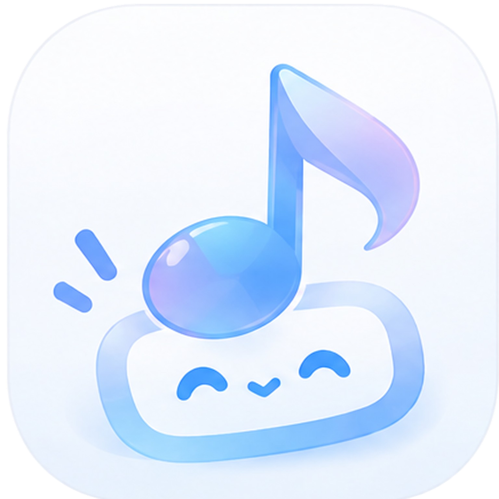

# 音绘

**以 B 站为基底的音乐播放器，把喜欢的声音装进随身音乐库。**

音绘（MeloCanvas）是一款免费的 Android 音乐与听视频应用：后台听歌、导入收藏与歌单、看歌词、换主题，也可以把长视频放进独立队列慢慢听。

### [⬇ 一键下载音绘安卓 APK](https://github.com/lxiaodong681-lab/MeloCanvas-Public/releases/download/v0.19.4-beta.1/MeloCanvas-0.19.4-Build35-arm64-v8a.apk)

**0.19.4 Beta 1 · Build 35 · 68.6 MB · Android 8.0 及以上 · ARM64**

点击上面的链接直接下载安装包，下载后在手机中打开即可按提示安装。首次使用需要联网和 B 站账号；旧版用户请先备份，再覆盖安装。

[安装与锁屏常见问题](INSTALL.md) · [本版更新与全部附件](https://github.com/lxiaodong681-lab/MeloCanvas-Public/releases/tag/v0.19.4-beta.1) · [反馈建议](https://github.com/lxiaodong681-lab/MeloCanvas-Public/issues)

## 可以做什么

| 功能 | 你可以怎样使用 |
| --- | --- |
| **B 站听歌** | 扫码登录、搜索歌曲，导入收藏夹；后台播放，通知栏与锁屏控制。 |
| **听视频** | 与音乐分开管理播放队列，切换分 P、章节和字幕，听长视频更方便。 |
| **歌单搬家** | 导入网易云、QQ、酷我、汽水的公开歌单目录，再匹配 B 站音源；酷狗支持部分分享页预览。 |
| **心动候选** | 在私人 FM 中根据已保存的歌单寻找相似内容，播放记录只作低权重参考（试验功能）。 |
| **自己的音乐库** | 管理喜欢、歌单、最近播放和本地音频；保留随机 / 顺序 / 循环偏好，备份与恢复音乐库。 |
| **歌词与睡眠定时** | 查看本地或在线歌词，睡前设置自动暂停。 |
| **主题与看板娘** | 使用内置外观和主题包，配合音绘 OC 开屏与八态场景插图。 |

歌单导入读取的是歌曲目录，实际播放匹配到的 B 站内容；匹配结果需要核对。酷狗目录不完整时会提示。心动候选基于关键词查找，尚不是成熟的个性化推荐服务。详见 [歌单导入与心动推荐](docs/music-discovery.md)。

内容可用性、歌词准确性、登录和离线播放会受账号权限、平台接口和设备影响。下载只适用于已获许可且应用能够读取的内容；离线入口也有已有会话及完整文件等条件。首次使用需要联网和 B 站账号。本项目不提供独立曲库、云端音乐库同步，也不提供绕过付费、地区或账号权限限制的功能。

## 支持哪些设备

| 平台 | 当前状态 |
| --- | --- |
| **Android 8.0 及以上的 ARM64 设备** | 已提供上方可直接安装的 APK；具体机型兼容性仍需测试。 |
| iPhone / iPad（iOS） | 尚未完成音绘的完整适配，没有可安装的发行版。 |
| Windows / macOS / Linux | 暂无原生桌面客户端或安装包。 |
| 浏览器 | 仓库中的设计原型用于界面预览，不是可日常听歌的网页版。 |

32 位安卓设备不支持当前 APK；x86_64 仅用于开发模拟器，未作为用户版本发行。APK 不能直接作为电脑或 iPhone 安装程序使用。

## 安装与反馈

下载的是以 `.apk` 结尾的文件。Release 中的 `source.zip`、`Source code`、LGPL 和依赖材料是源码与分发附件，不是手机安装包。无需下载整个仓库，也无需自行编译。

安装、校验、覆盖升级和锁屏通知常见问题见 [安装指南](INSTALL.md)。本版 [SHA-256 校验清单](https://github.com/lxiaodong681-lab/MeloCanvas-Public/releases/download/v0.19.4-beta.1/SHA256SUMS.txt) 和签名证书摘要随发行提供；旧内部包及 CI 未签名产物不能代替发行包。

测试版可能出现播放、登录、主题、耗电和数据兼容问题。安装前导出重要资料，并确认备份已经保存到应用以外的位置。音绘免费使用；自愿打赏不解锁功能，也不构成稳定性或维护承诺。

问题或建议请提交到 [公开 Issues](https://github.com/lxiaodong681-lab/MeloCanvas-Public/issues)。反馈请注明版本 / Build、Android 版本、机型、复现步骤和预期结果。截图请遮盖头像、昵称、收藏夹和二维码；不要上传 Cookie、登录二维码、完整日志、备份或设备序列号。涉及隐私或安全的问题请按 [安全反馈说明](SECURITY.md) 私下联系。

## 隐私与授权

音绘基于 [BBPlayer](https://github.com/bbplayer-app/BBPlayer) 开发，是非官方客户端，与哔哩哔哩、BBPlayer 的维护者均无官方隶属或背书关系。当前为早期公开 Beta，验证范围见 [版本说明](docs/public-beta-status.md)。

- [MeloCanvas MIT 许可证](LICENSE)：覆盖自有代码及明确标注 MIT 的素材；第三方和既有 CC0 授权保持原许可。
- [OC 素材专用许可](android-app/apps/mobile/melo/assets/mascot/LICENSE.txt)：看板娘立绘及八态贴纸由维护者保留权利，仅允许随音绘使用和分发，其他用途须另行取得许可；不适用 MIT。
- [隐私说明](PRIVACY.md)：本机资料、第三方请求、备份与删除范围。
- [第三方声明与素材清单](THIRD_PARTY_NOTICES.md)：源码许可与图片、音视频、歌词、字幕等内容权利分别处理。
- [BBPlayer MIT 许可证](android-app/LICENSE)：保留原作者版权与完整许可文本。项目的学习交流目的不缩减 MIT 授予的权利，也不授予任何第三方内容的传播许可。

## 源码与开发

正式入口为 `android-app/apps/mobile/index.js` → `melo/account-root.tsx`，包名为 `org.melocanvas.app`。版本以 `app.config.ts` 与已提交 Android Gradle 配置为准；上游 workspace 的 package.json 版本不是音绘安装包版本。

按仓库 `.node-version` 安装 Node，使用 `android-app/package.json` 指定的 pnpm。在 `android-app/` 执行：

```sh
pnpm install --frozen-lockfile --ignore-scripts
pnpm type-check
pnpm lint
```

构建、签名、工具链与 CI 见 [Android 开发构建指南](docs/android-build.md)，上游来源见 [BBPlayer 维护说明](docs/upstream.md)。正式更新必须保留签名身份。用户可按 [LGPL 重建说明](docs/lgpl-distribution.md) 修改依赖并自行签名安装；自签名不等于官方覆盖更新。开发记录不是面向用户的发行说明，原始设备证据应留在私有存储中。
